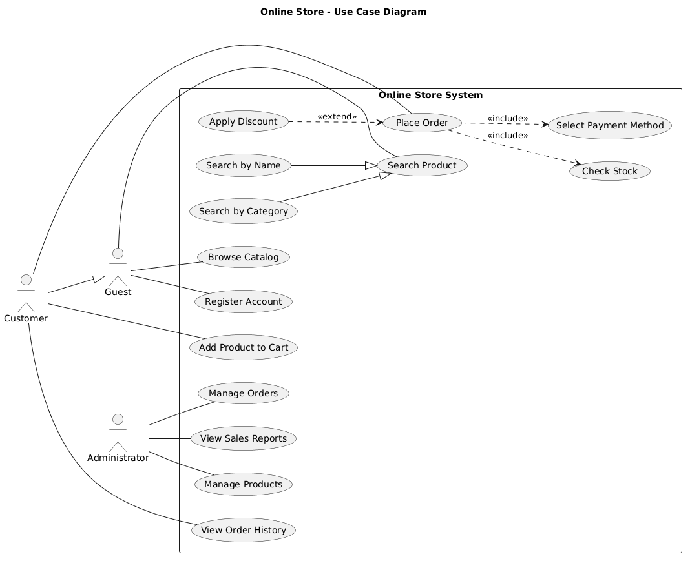
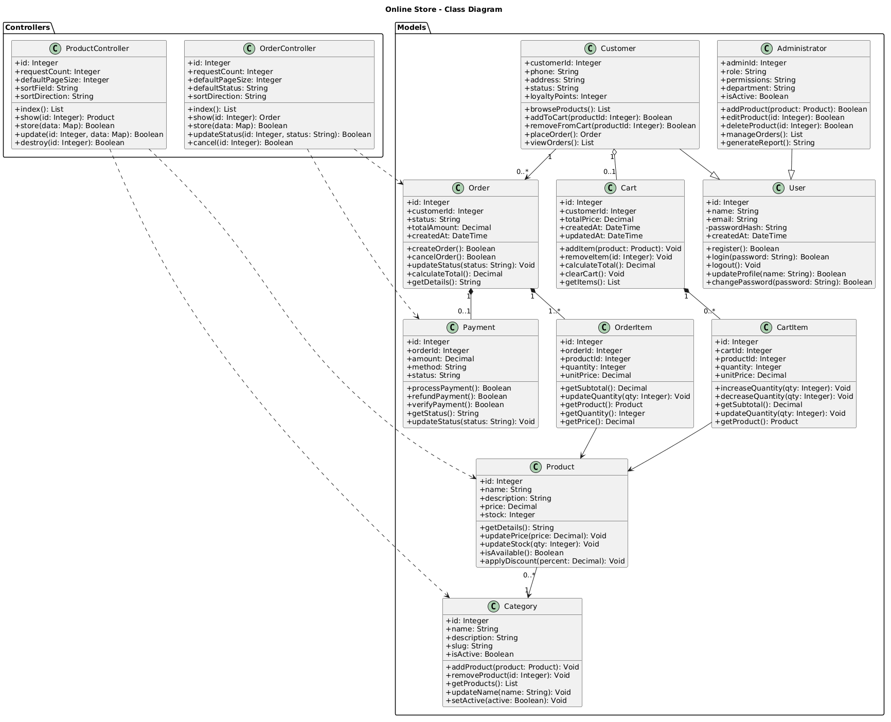

# Online Store — System Architecture

## 1. Опис предметної галузі

Інтернет-магазин — це вебсистема, призначена для
автоматизації процесу продажу товарів через інтернет.

Система дозволяє користувачам переглядати каталог
товарів, здійснювати пошук, додавати товари до кошика,
оформлювати замовлення та переглядати історію покупок.

Адміністратор має можливість керувати товарами,
категоріями, замовленнями та переглядати статистику
продажів.

Система проєктується з використанням PHP/Laravel
на основі архітектурного шаблону MVC
(Model-View-Controller).

## 2. Основні функції системи

1. Реєстрація нових користувачів.
2. Авторизація користувачів.
3. Перегляд каталогу товарів.
4. Пошук товарів за назвою та категорією.
5. Перегляд детальної інформації про товар.
6. Додавання товарів до кошика.
7. Видалення товарів із кошика.
8. Оформлення замовлень.
9. Перегляд історії замовлень.
10. Керування товарами та категоріями.
11. Обробка замовлень адміністратором.
12. Формування звітів про продажі.

## 3. Користувачі системи

### 3.1 Guest (Гість)

Неавторизований користувач, який може:
- Переглядати каталог товарів.
- Здійснювати пошук товарів.
- Переглядати інформацію про товари.
- Зареєструвати обліковий запис.

### 3.2 Customer (Покупець)

Зареєстрований користувач, який може:
- Авторизуватися в системі.
- Переглядати каталог товарів.
- Додавати товари до кошика.
- Оформлювати замовлення.
- Переглядати історію покупок.
- Редагувати особисті дані.

### 3.3 Administrator (Адміністратор)

Користувач із розширеними правами, який може:
- Додавати нові товари.
- Редагувати інформацію про товари.
- Видаляти товари.
- Керувати категоріями.
- Переглядати та обробляти замовлення.
- Формувати звіти про продажі.

## 4. Архітектура системи (MVC)

Для розробки інтернет-магазину обрано архітектурний
шаблон MVC (Model-View-Controller), який використовується
у фреймворку Laravel.

MVC розділяє застосунок на три основні компоненти:

### 4.1 Model (Модель)

Модель відповідає за роботу з даними та бізнес-логікою
системи. Вона забезпечує взаємодію з базою даних,
отримання, збереження, оновлення та видалення інформації.

Основні моделі інтернет-магазину:
- User — інформація про користувачів.
- Product — інформація про товари.
- Category — категорії товарів.
- Cart — кошик покупця.
- Order — замовлення покупців.
- Payment — інформація про оплату.

### 4.2 View (Представлення)

View відповідає за відображення інформації користувачеві
через вебінтерфейс.

Основні представлення:
- Сторінка реєстрації та авторизації.
- Головна сторінка інтернет-магазину.
- Каталог товарів.
- Сторінка окремого товару.
- Кошик покупця.
- Сторінка оформлення замовлення.
- Панель адміністратора.

У Laravel для створення представлень може
використовуватися шаблонізатор Blade.

### 4.3 Controller (Контролер)

Контролер обробляє HTTP-запити користувачів,
взаємодіє з моделями та передає необхідні
дані до представлень.

Основні контролери:
- AuthController — реєстрація та авторизація.
- ProductController — керування товарами.
- CategoryController — керування категоріями.
- CartController — робота з кошиком.
- OrderController — обробка замовлень.
- PaymentController — обробка платежів.

### 4.4 Принцип роботи MVC

1. Користувач виконує дію у вебінтерфейсі.
2. Браузер надсилає HTTP-запит на сервер.
3. Маршрутизатор Laravel передає запит контролеру.
4. Контролер звертається до необхідної моделі.
5. Модель взаємодіє з базою даних.
6. Контролер отримує результат обробки.
7. Система формує HTTP-відповідь.
8. Користувач бачить результат у браузері.

## 5. Основні сценарії роботи системи

### 5.1 Сценарій 1 — Реєстрація користувача

1. Гість відкриває головну сторінку інтернет-магазину.
2. Натискає кнопку "Реєстрація".
3. Система відображає форму реєстрації.
4. Користувач вводить ім'я, електронну пошту та пароль.
5. Натискає кнопку "Зареєструватися".
6. Система перевіряє правильність введених даних.
7. Система перевіряє, чи не використовується електронна пошта.
8. Якщо всі дані правильні, створюється новий обліковий запис.
9. Система повідомляє про успішну реєстрацію.
10. Користувач може авторизуватися в системі.

### 5.2 Сценарій 2 — Оформлення замовлення

1. Покупець авторизується в інтернет-магазині.
2. Відкриває каталог товарів.
3. Знаходить потрібний товар.
4. Переглядає детальну інформацію про нього.
5. Вказує необхідну кількість товару.
6. Додає товар до кошика.
7. Переходить до кошика.
8. Перевіряє обрані товари та загальну суму.
9. Натискає кнопку "Оформити замовлення".
10. Вказує адресу доставки.
11. Обирає спосіб оплати.
12. Система перевіряє наявність товарів.
13. Покупець підтверджує замовлення.
14. Система зберігає замовлення в базі даних.
15. Покупець отримує підтвердження оформлення.

### 5.3 Сценарій 3 — Додавання нового товару

1. Адміністратор авторизується в системі.
2. Переходить до панелі адміністратора.
3. Відкриває розділ "Керування товарами".
4. Натискає кнопку "Додати товар".
5. Система відображає форму створення товару.
6. Адміністратор вводить назву товару.
7. Додає опис, ціну та кількість на складі.
8. Обирає категорію товару.
9. Натискає кнопку "Зберегти".
10. Система перевіряє введені дані.
11. Створює новий запис у базі даних.
12. Новий товар з'являється в каталозі.

## 6. Логічні сутності та структура бази даних

Для збереження інформації інтернет-магазину
передбачається використання реляційної бази даних.

### 6.1 Основні логічні сутності

1. User — користувач системи.
2. Customer — профіль покупця.
3. Product — товар інтернет-магазину.
4. Category — категорія товарів.
5. Cart — кошик покупця.
6. CartItem — окремий товар у кошику.
7. Order — замовлення покупця.
8. OrderItem — товар у складі замовлення.
9. Payment — інформація про оплату.
10. Address — адреса доставки.

### 6.2 Основні таблиці бази даних

| Таблиця | Основні поля | Призначення |
|---------|--------------|-------------|
| users | id, name, email, password | Дані користувачів |
| customers | id, user_id, phone | Профілі покупців |
| products | id, name, price, stock, category_id | Дані товарів |
| categories | id, name, description | Категорії товарів |
| carts | id, customer_id, total_price | Кошики покупців |
| cart_items | id, cart_id, product_id, quantity | Товари в кошику |
| orders | id, customer_id, total_amount, status | Замовлення |
| order_items | id, order_id, product_id, quantity | Склад замовлень |
| payments | id, order_id, amount, method, status | Платежі |
| addresses | id, customer_id, city, street | Адреси доставки |

### 6.3 Зв'язки між сутностями

- Один користувач може мати профіль покупця.
- Один покупець може створювати багато замовлень.
- Одна категорія може містити багато товарів.
- Один кошик може містити багато позицій товарів.
- Кожна позиція кошика посилається на певний товар.
- Одне замовлення містить одну або декілька позицій.
- Кожна позиція замовлення пов'язана з певним товаром.
- Одне замовлення може мати пов'язаний платіж.
- Один покупець може зберігати декілька адрес доставки.

## 7. Вихідні дані системи (Output)

Інтернет-магазин формує вихідну інформацію
для покупців та адміністраторів.

### 7.1 Каталог товарів

Система відображає перелік доступних товарів
із зазначенням:
- Назви товару.
- Категорії.
- Ціни.
- Кількості на складі.
- Опису товару.

### 7.2 Історія замовлень

Покупець може переглядати список своїх
попередніх замовлень.

Для кожного замовлення відображається:
- Номер замовлення.
- Дата оформлення.
- Перелік товарів.
- Загальна сума.
- Поточний статус замовлення.

### 7.3 Звіт про продажі

Адміністратор може сформувати звіт,
який містить:
- Кількість замовлень.
- Загальну суму продажів.
- Найпопулярніші товари.
- Продажі за вибраний період.
- Графік динаміки продажів.

### 7.4 Звіт про залишки товарів

Система формує таблицю з інформацією про:
- Назву товару.
- Категорію.
- Поточну кількість на складі.
- Товари з низьким залишком.
- Товари, яких немає в наявності.

## 8. Варіанти використання системи (Use Cases)

Use Case описує взаємодію користувача із системою
для досягнення певної мети.

Для інтернет-магазину розроблено три варіанти
використання: короткий, поверхневий та повний.

### 8.1 Коротка форма — Реєстрація користувача

**Use Case Name:** Register Account

**Primary Actor:** Guest (Гість)

**Опис:**

Гість відкриває сторінку реєстрації інтернет-магазину
та заповнює форму, вказуючи своє ім'я, адресу
електронної пошти та пароль.

Після введення даних користувач натискає кнопку
"Зареєструватися". Система перевіряє правильність
введеної інформації та унікальність електронної пошти.

Якщо всі дані відповідають вимогам, система створює
новий обліковий запис у базі даних та відображає
повідомлення про успішну реєстрацію.

Після цього користувач може авторизуватися
в інтернет-магазині.

### 8.2 Поверхнева форма — Додавання товару до кошика

**Use Case Name:** Add Product to Cart

**Primary Actor:** Customer (Покупець)

**Мета:** Додати вибраний товар до кошика для
подальшого оформлення замовлення.

#### Головний успішний сценарій

1. Покупець відкриває каталог інтернет-магазину.
2. Знаходить потрібний товар.
3. Переходить на сторінку товару.
4. Переглядає назву, опис, ціну та наявність.
5. Обирає необхідну кількість товару.
6. Натискає кнопку "Додати до кошика".
7. Система перевіряє наявність товару на складі.
8. Система додає товар до кошика покупця.
9. Система оновлює загальну вартість кошика.
10. Покупець отримує повідомлення про успішне
    додавання товару.

#### Альтернативні сценарії

**А1. Товар відсутній на складі.**
Система повідомляє покупця, що товар
тимчасово недоступний, і не додає його до кошика.

**А2. Недостатня кількість товару.**
Якщо покупець вибрав більше одиниць товару,
ніж є на складі, система показує доступну кількість
та пропонує її змінити.

**А3. Некоректна кількість.**
Якщо покупець вводить нульове, від'ємне або
нечислове значення, система відображає помилку
та просить вказати правильну кількість.

**А4. Товар уже є в кошику.**
Якщо вибраний товар уже доданий до кошика,
система збільшує його кількість після перевірки
доступного залишку.

**А5. Технічна помилка.**
У разі збою сервера або бази даних
система відображає повідомлення про помилку.
Товар не додається до кошика, якщо операція
не була успішно завершена.

### 8.3 Повна форма — Оформлення замовлення

**Use Case Name:** Place Order

**Scope:** Online Store System (System)

**Level:** User-goal

**Primary Actor:** Customer (Покупець)

#### Stakeholders and Interests

1. Покупець — зацікавлений у швидкому,
   зручному та безпечному оформленні замовлення.
2. Адміністратор — зацікавлений у правильній
   обробці замовлень і контролі залишків.
3. Власник магазину — зацікавлений в успішних
   продажах та коректному обліку замовлень.

#### Preconditions

1. Покупець авторизований у системі.
2. Покупець має хоча б один товар у кошику.
3. Система доступна для оформлення замовлень.

#### Success Guarantee

1. Замовлення створено та збережено в базі даних.
2. Замовленню присвоєно унікальний номер.
3. Система зберегла склад і загальну суму замовлення.
4. Покупець отримав підтвердження оформлення.
5. Статус оплати відповідає результату платежу.

#### Main Success Scenario

1. Покупець авторизується в інтернет-магазині.
2. Відкриває каталог товарів.
3. Знаходить необхідний товар за допомогою пошуку.
4. Переглядає інформацію про вибраний товар.
5. Вказує необхідну кількість товару.
6. Додає товар до кошика.
7. Переходить до кошика.
8. Перевіряє список товарів та загальну суму.
9. Натискає кнопку "Оформити замовлення".
10. Система відображає форму оформлення.
11. Покупець вводить адресу доставки.
12. Покупець обирає спосіб оплати.
13. Система перевіряє правильність даних.
14. Система перевіряє наявність товарів.
15. Система розраховує загальну вартість.
16. Покупець підтверджує замовлення.
17. Система створює замовлення в базі даних.
18. Система присвоює замовленню номер.
19. Система відображає підтвердження оформлення.
20. Покупець переглядає інформацію про замовлення.

#### Extensions (Альтернативні сценарії)

**А1. Товар відсутній на складі (крок 14)**

1. Система визначає, що товар недоступний.
2. Відображає повідомлення про відсутність.
3. Пропонує покупцеві змінити склад кошика.
4. Оформлення замовлення призупиняється.

**А2. Недостатня кількість товару (крок 14)**

1. Система порівнює замовлену кількість із залишком.
2. Повідомляє покупцеві доступну кількість.
3. Пропонує зменшити кількість товару.
4. Після зміни кількості перевірка повторюється.

**А3. Некоректна адреса доставки (крок 13)**

1. Система виявляє некоректні або порожні поля.
2. Відображає повідомлення про помилку.
3. Покупець виправляє адресу доставки.
4. Система повторно перевіряє дані.

**А4. Покупець скасовує замовлення (крок 16)**

1. Покупець натискає кнопку "Скасувати".
2. Система припиняє оформлення замовлення.
3. Покупець повертається до кошика.
4. Нове замовлення не створюється.

**А5. Помилка збереження замовлення (крок 17)**

1. Виникає збій під час запису в базу даних.
2. Система скасовує незавершену транзакцію.
3. Відображає повідомлення про помилку.
4. Покупець може повторити оформлення.

**А6. Помилка онлайн-оплати (після кроку 17)**

1. Покупець переходить до онлайн-оплати.
2. Платіжний сервіс повертає помилку.
3. Система фіксує статус оплати "Failed".
4. Замовлення не позначається як оплачене.
5. Покупець може повторити оплату.

#### Special Requirements

1. Система повинна забезпечувати захист
   персональних даних користувачів.
2. Усі дані замовлення мають перевірятися
   перед збереженням.
3. Необхідно запобігати продажу товарів,
   кількість яких перевищує доступний залишок.
4. Система повинна обробляти помилки
   та показувати зрозумілі повідомлення.

#### Technology and Data Variations List

1. Вебзастосунок розробляється на PHP/Laravel.
2. Для збереження даних використовується
   реляційна база даних.
3. Покупець може вибирати різні способи оплати.
4. Інформація про замовлення обробляється
   контролерами Laravel.
5. Для роботи з таблицями використовуються
   моделі Eloquent ORM.

#### Frequency of Occurrence

Варіант використання виконується кожного разу,
коли покупець оформлює нове замовлення.
Точна частота залежить від активності покупців.

#### Miscellaneous (Open Issues)

1. Необхідно визначити доступні способи доставки.
2. Потрібно встановити правила повернення товарів.
3. Необхідно визначити умови скасування замовлення.
4. Потрібно уточнити інтеграцію платіжного сервісу.

## 9. UML-діаграма варіантів використання

Для візуалізації функціональних можливостей
інтернет-магазину розроблено UML-діаграму
варіантів використання (Use Case Diagram).

Діаграма містить трьох акторів:
- Guest — неавторизований користувач.
- Customer — зареєстрований покупець.
- Administrator — адміністратор системи.

На діаграмі відображено функції, доступні
кожному актору, а також зв'язки association,
generalization, include та extend.

Рисунок 1 — UML-діаграма варіантів використання
інтернет-магазину.

## 10. UML-діаграма класів (Class Diagram)

Для відображення логічної структури інтернет-магазину
розроблено UML-діаграму класів (Class Diagram).

Діаграма містить 12 класів, які описують основні
сутності системи, їхні атрибути, методи та зв'язки.

### 10.1 Основні класи системи

- User — базова інформація про користувача.
- Customer — зареєстрований покупець.
- Administrator — адміністратор системи.
- Product — товар інтернет-магазину.
- Category — категорія товарів.
- Cart — кошик покупця.
- CartItem — окрема позиція кошика.
- Order — замовлення покупця.
- OrderItem — окрема позиція замовлення.
- Payment — інформація про оплату.
- ProductController — контролер товарів.
- OrderController — контролер замовлень.

### 10.2 Зв'язки між класами

У діаграмі використано такі типи зв'язків:

1. Association (асоціація) — зв'язок між
   незалежними об'єктами, наприклад Product і Category.

2. Aggregation (агрегація) — відношення
   "частина — ціле", наприклад Customer і Cart.

3. Composition (композиція) — сильний зв'язок
   між об'єктами, наприклад Order і OrderItem.

4. Generalization (наслідування) — створення
   спеціалізованих класів на основі базового
   класу User.

### 10.3 Архітектура MVC

Класи розділено на дві основні групи:

- Models — класи, які представляють дані
  та бізнес-логіку інтернет-магазину.
- Controllers — класи, які обробляють запити
  користувачів та взаємодіють із моделями.

### 10.4 Діаграма класів

Рисунок 2 — UML-діаграма класів інтернет-магазину.
