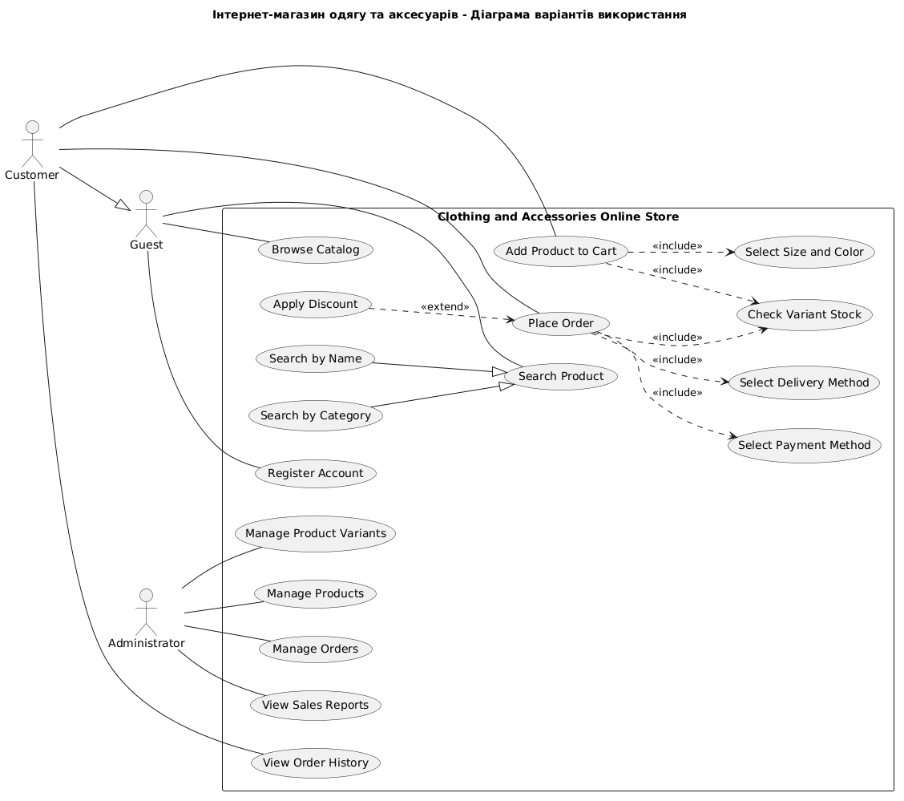
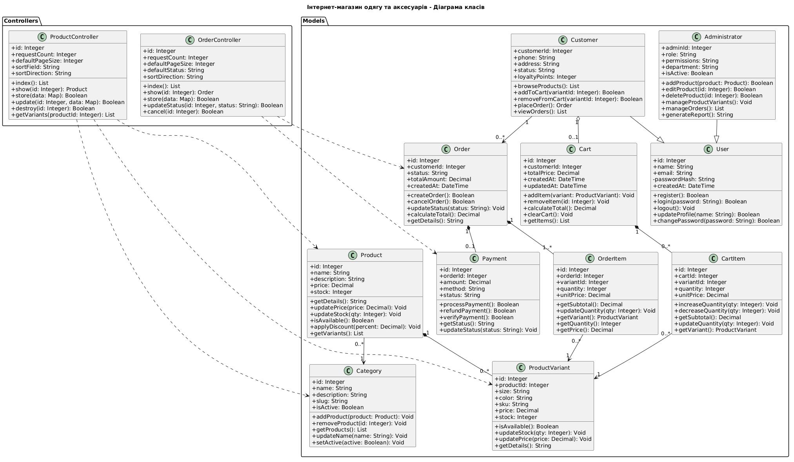

# Clothing & Accessories Online Store — System Architecture

## 1. Опис предметної галузі

Інтернет-магазин одягу та аксесуарів — це вебсистема,
призначена для онлайн-продажу одягу, взуття, сумок
та різноманітних аксесуарів.

Система дозволяє користувачам переглядати каталог,
знаходити товари за назвою, категорією, розміром,
кольором і ціною, переглядати характеристики товарів,
додавати вибрані товари до кошика та оформлювати
замовлення.

Особливістю інтернет-магазину є можливість вибору
конкретного варіанта товару за розміром і кольором.
Наприклад, одна модель футболки може бути доступна
в декількох розмірах і кольорах, кожен із яких має
окремий залишок на складі.

Адміністратор має можливість додавати нові товари,
керувати категоріями, розмірами, кольорами,
залишками на складі, обробляти замовлення
та переглядати статистику продажів.

Система проєктується з використанням PHP/Laravel
на основі архітектурного шаблону MVC
(Model-View-Controller).

## 2. Основні функції системи

1. Реєстрація нових користувачів.
2. Авторизація користувачів.
3. Перегляд каталогу одягу та аксесуарів.
4. Пошук товарів за назвою та категорією.
5. Фільтрація товарів за розміром, кольором і ціною.
6. Перегляд детальної інформації про товар.
7. Вибір розміру та кольору товару.
8. Перевірка наявності вибраного варіанта товару.
9. Додавання товарів до кошика.
10. Зміна кількості та видалення товарів із кошика.
11. Оформлення замовлень.
12. Вибір способу доставки та оплати.
13. Перегляд історії замовлень.
14. Керування товарами та категоріями.
15. Керування розмірами, кольорами та залишками.
16. Обробка замовлень адміністратором.
17. Формування звітів про продажі.
18. Формування звітів про залишки товарів.

## 3. Користувачі системи

### 3.1 Guest (Гість)

Неавторизований користувач інтернет-магазину,
який може:

- Переглядати каталог одягу, взуття та аксесуарів.
- Шукати товари за назвою та категорією.
- Фільтрувати товари за розміром, кольором і ціною.
- Переглядати фотографії, опис і характеристики товарів.
- Перевіряти наявність потрібного розміру та кольору.
- Зареєструвати обліковий запис.

### 3.2 Customer (Покупець)

Зареєстрований користувач, який може:

- Авторизуватися в інтернет-магазині.
- Переглядати каталог товарів.
- Використовувати пошук і фільтрацію.
- Обирати необхідний розмір і колір товару.
- Додавати вибрані варіанти товарів до кошика.
- Змінювати кількість товарів у кошику.
- Видаляти товари з кошика.
- Оформлювати замовлення.
- Обирати спосіб доставки та оплати.
- Переглядати історію замовлень.
- Редагувати особисті дані.

### 3.3 Administrator (Адміністратор)

Користувач із розширеними правами, який може:

- Додавати новий одяг, взуття та аксесуари.
- Редагувати назви, описи та ціни товарів.
- Додавати фотографії товарів.
- Створювати та редагувати категорії.
- Додавати доступні розміри й кольори.
- Керувати окремими варіантами товарів.
- Оновлювати залишки товарів на складі.
- Видаляти або приховувати товари з каталогу.
- Переглядати та обробляти замовлення.
- Змінювати статуси замовлень.
- Формувати звіти про продажі та залишки.

## 4. Архітектура системи (MVC)

Для розробки інтернет-магазину одягу та аксесуарів
обрано архітектурний шаблон MVC
(Model-View-Controller), який використовується
у фреймворку Laravel.

MVC розділяє застосунок на три основні компоненти:
Model, View та Controller.

### 4.1 Model (Модель)

Модель відповідає за роботу з даними та
бізнес-логікою системи.

Вона забезпечує отримання, збереження,
оновлення та видалення інформації в базі даних.

Основні моделі інтернет-магазину:

- User — інформація про користувачів.
- Customer — профіль покупця.
- Product — загальна інформація про товар.
- ProductVariant — конкретний розмір і колір товару.
- Category — категорії одягу та аксесуарів.
- Cart — кошик покупця.
- CartItem — позиція кошика з вибраним варіантом.
- Order — замовлення покупця.
- OrderItem — позиція оформленого замовлення.
- Payment — інформація про оплату.
- Address — адреса доставки.

Модель Product зберігає загальні характеристики
товару, наприклад назву, опис і категорію.

Модель ProductVariant зберігає характеристики
конкретного варіанта товару: розмір, колір,
ціну та кількість на складі.

### 4.2 View (Представлення)

View відповідає за відображення інформації
користувачеві через вебінтерфейс.

Основні представлення:

- Головна сторінка магазину.
- Сторінка реєстрації та авторизації.
- Каталог одягу та аксесуарів.
- Сторінка товару з фотографіями.
- Вибір розміру та кольору товару.
- Кошик покупця.
- Сторінка оформлення замовлення.
- Історія замовлень.
- Панель адміністратора.
- Сторінка керування варіантами товарів.

У Laravel для створення представлень
може використовуватися шаблонізатор Blade.

### 4.3 Controller (Контролер)

Контролер приймає HTTP-запити користувачів,
взаємодіє з моделями та передає дані
до відповідних представлень.

Основні контролери:

- AuthController — реєстрація та авторизація.
- ProductController — керування товарами.
- ProductVariantController — керування розмірами,
  кольорами та залишками варіантів товарів.
- CategoryController — керування категоріями.
- CartController — робота з кошиком.
- OrderController — оформлення замовлень.
- PaymentController — обробка платежів.

### 4.4 Принцип роботи MVC

1. Покупець відкриває каталог інтернет-магазину.
2. Браузер надсилає HTTP-запит на сервер.
3. Маршрутизатор Laravel передає запит контролеру.
4. ProductController звертається до моделі Product.
5. Модель отримує дані про товари.
6. Покупець відкриває сторінку вибраного товару.
7. Система отримує доступні варіанти ProductVariant.
8. Покупець обирає розмір і колір.
9. Контролер перевіряє наявність вибраного варіанта.
10. Після підтвердження товар додається до кошика.
11. Система формує відповідь.
12. Користувач бачить оновлений кошик.

## 5. Основні сценарії роботи системи

### 5.1 Сценарій 1 — Реєстрація користувача

1. Гість відкриває головну сторінку інтернет-магазину одягу та аксесуарів.
2. Натискає кнопку "Реєстрація".
3. Система відображає форму реєстрації.
4. Користувач вводить ім'я, електронну пошту та пароль.
5. Натискає кнопку "Зареєструватися".
6. Система перевіряє правильність введених даних.
7. Система перевіряє, чи не використовується електронна пошта.
8. Якщо дані правильні, створюється новий обліковий запис.
9. Система повідомляє про успішну реєстрацію.
10. Користувач може авторизуватися та здійснювати покупки.

### 5.2 Сценарій 2 — Оформлення замовлення

1. Покупець авторизується в інтернет-магазині.
2. Відкриває каталог одягу та аксесуарів.
3. Знаходить потрібний товар за назвою або категорією.
4. За потреби фільтрує товари за розміром, кольором і ціною.
5. Відкриває сторінку вибраного товару.
6. Переглядає фотографії, опис, ціну та характеристики.
7. Обирає потрібний розмір і колір.
8. Система перевіряє наявність вибраного варіанта товару.
9. Покупець вказує кількість і додає товар до кошика.
10. Переходить до кошика.
11. Перевіряє товари, розміри, кольори та загальну суму.
12. Натискає кнопку "Оформити замовлення".
13. Вводить адресу доставки та обирає спосіб доставки.
14. Обирає спосіб оплати.
15. Система повторно перевіряє залишки вибраних варіантів товарів.
16. Система розраховує загальну вартість замовлення.
17. Покупець підтверджує замовлення.
18. Система зберігає замовлення та його позиції в базі даних.
19. Замовленню присвоюється унікальний номер.
20. Покупець отримує підтвердження оформлення замовлення.

### 5.3 Сценарій 3 — Додавання нового товару

1. Адміністратор авторизується в системі.
2. Переходить до панелі адміністратора.
3. Відкриває розділ "Керування товарами".
4. Натискає кнопку "Додати товар".
5. Система відображає форму створення товару.
6. Адміністратор вводить назву товару та опис.
7. Обирає категорію: одяг, взуття або аксесуари.
8. Додає фотографії та основну інформацію про товар.
9. Створює доступні варіанти товару за розміром і кольором.
10. Для кожного варіанта встановлює ціну та кількість на складі.
11. Натискає кнопку "Зберегти".
12. Система перевіряє правильність введених даних.
13. Система зберігає товар і його варіанти в базі даних.
14. Новий товар з'являється в каталозі інтернет-магазину.

## 6. Логічні сутності та структура бази даних

Для збереження інформації інтернет-магазину одягу
та аксесуарів передбачається використання
реляційної бази даних.

Особливістю структури є окреме збереження
варіантів товарів за розміром і кольором.

### 6.1 Основні логічні сутності

1. User — користувач системи.
2. Customer — профіль зареєстрованого покупця.
3. Product — загальна інформація про товар.
4. ProductVariant — конкретний варіант товару за розміром і кольором.
5. Category — категорія одягу, взуття або аксесуарів.
6. Cart — кошик покупця.
7. CartItem — позиція кошика з вибраним варіантом товару.
8. Order — замовлення покупця.
9. OrderItem — позиція замовлення.
10. Payment — інформація про оплату.
11. Address — адреса доставки.

### 6.2 Основні таблиці бази даних

| Таблиця | Основні поля | Призначення |
|---------|--------------|-------------|
| users | id, name, email, password | Дані користувачів |
| customers | id, user_id, phone | Профілі покупців |
| categories | id, name, description | Категорії товарів |
| products | id, name, description, category_id | Загальна інформація про товари |
| product_variants | id, product_id, size, color, sku, price, stock | Розміри, кольори, ціни та залишки |
| carts | id, customer_id, total_price | Кошики покупців |
| cart_items | id, cart_id, product_variant_id, quantity | Вибрані варіанти товарів у кошику |
| orders | id, customer_id, total_amount, status | Замовлення |
| order_items | id, order_id, product_variant_id, quantity, unit_price | Склад замовлень |
| payments | id, order_id, amount, method, status | Інформація про платежі |
| addresses | id, customer_id, city, street | Адреси доставки |

### 6.3 Зв'язки між сутностями

- Один користувач може мати профіль покупця.
- Один покупець може оформити багато замовлень.
- Одна категорія може містити багато товарів.
- Один товар може мати декілька варіантів ProductVariant.
- Кожен ProductVariant належить одному товару.
- Один кошик може містити багато позицій CartItem.
- Кожна позиція кошика пов'язана з конкретним ProductVariant.
- Одне замовлення може містити декілька позицій OrderItem.
- Кожна позиція замовлення містить дані про вибраний варіант товару.
- Одне замовлення може мати пов'язаний платіж.
- Один покупець може мати декілька адрес доставки.

### 6.4 Особливості збереження варіантів товарів

Для одного товару Product може існувати багато
записів ProductVariant.

Наприклад, футболка Basic може мати такі варіанти:

| Розмір | Колір | Ціна | Залишок |
|--------|-------|------|---------|
| S | Чорний | 650 грн | 12 |
| M | Чорний | 650 грн | 8 |
| M | Білий | 650 грн | 15 |
| L | Білий | 650 грн | 4 |

Кожен варіант має власний ідентифікатор
та артикул SKU.

Під час додавання товару до кошика система
зберігає ідентифікатор ProductVariant,
що дозволяє правильно визначити вибраний
розмір, колір та доступну кількість.

У позиції оформленого замовлення також
зберігаються ціна на момент покупки та
вибраний варіант товару.

## 7. Вихідні дані системи (Output)

Інтернет-магазин одягу та аксесуарів формує
інформацію для покупців і адміністраторів.

### 7.1 Каталог товарів

Система відображає перелік товарів із зазначенням:

- Назви товару.
- Категорії.
- Фотографій та опису.
- Ціни.
- Доступних розмірів.
- Доступних кольорів.
- Інформації про наявність товару.

Покупець може фільтрувати товари
за категорією, розміром, кольором і ціною.

### 7.2 Історія замовлень

Покупець може переглядати попередні замовлення.

Для кожного замовлення відображаються:

- Номер і дата замовлення.
- Назви придбаних товарів.
- Вибрані розміри та кольори.
- Кількість товарів.
- Загальна вартість.
- Спосіб доставки.
- Поточний статус замовлення.

### 7.3 Звіт про продажі

Адміністратор може сформувати звіт,
який містить:

- Загальну кількість замовлень.
- Загальну суму продажів.
- Найпопулярніші категорії товарів.
- Найпопулярніші розміри та кольори.
- Найбільш продавані товари.
- Динаміку продажів за вибраний період.

### 7.4 Звіт про залишки товарів

Система формує таблицю залишків,
яка містить:

- Назву товару.
- Артикул SKU.
- Категорію.
- Розмір і колір.
- Кількість на складі.
- Варіанти з низьким залишком.
- Варіанти, яких немає в наявності.

## 8. Варіанти використання системи (Use Cases)

Use Case — це опис взаємодії користувача із системою
для досягнення певної мети.

Для інтернет-магазину одягу та аксесуарів розроблено
три варіанти використання: короткий, поверхневий
та повний.

### 8.1 Коротка форма — Реєстрація користувача

**Use Case Name:** Register Account

**Primary Actor:** Guest (Гість)

**Опис:**

Гість відкриває сторінку реєстрації інтернет-магазину
одягу та аксесуарів і заповнює форму, вказуючи
своє ім'я, електронну пошту та пароль.

Після введення даних користувач натискає кнопку
"Зареєструватися". Система перевіряє правильність
введеної інформації та унікальність електронної пошти.

Якщо всі дані відповідають вимогам, система створює
новий обліковий запис у базі даних та відображає
повідомлення про успішну реєстрацію.

Після реєстрації покупець може авторизуватися,
переглядати каталог одягу та аксесуарів,
обирати товари й оформлювати замовлення.

### 8.2 Поверхнева форма — Додавання товару до кошика

**Use Case Name:** Add Product to Cart

**Primary Actor:** Customer (Покупець)

**Мета:** Додати вибраний варіант одягу або аксесуара
до кошика для подальшого оформлення замовлення.

#### Головний успішний сценарій

1. Покупець відкриває каталог одягу та аксесуарів.
2. Знаходить потрібний товар за назвою або категорією.
3. За потреби використовує фільтри розміру, кольору та ціни.
4. Переходить на сторінку вибраного товару.
5. Переглядає фотографії, опис і характеристики товару.
6. Обирає потрібний розмір і колір, якщо вони передбачені для товару.
7. Система визначає відповідний ProductVariant.
8. Покупець вказує необхідну кількість товару.
9. Натискає кнопку "Додати до кошика".
10. Система перевіряє наявність вибраного варіанта на складі.
11. Система додає ProductVariant до кошика покупця.
12. Система перераховує загальну вартість кошика.
13. Покупець отримує повідомлення про успішне додавання товару.

#### Альтернативні сценарії

**А1. Вибраний розмір недоступний.**

Система повідомляє покупця про відсутність
обраного розміру та пропонує інші доступні розміри.

**А2. Вибраний колір недоступний.**

Система показує, що товар обраного кольору
відсутній, і пропонує доступні кольори.

**А3. Недостатня кількість вибраного варіанта.**

Якщо покупець обрав більше одиниць конкретного
варіанта товару, ніж є на складі, система
повідомляє доступну кількість і пропонує її змінити.

**А4. Не вибрано обов'язковий розмір або колір.**

Система не дозволяє додати товар до кошика
та просить вибрати необхідні характеристики.

**А5. Товар уже є в кошику.**

Якщо вибраний ProductVariant уже присутній
у кошику, система збільшує його кількість
після повторної перевірки залишку.

**А6. Некоректна кількість товару.**

Якщо покупець вводить нульове, від'ємне
або нечислове значення, система повідомляє
про помилку та просить вказати правильну кількість.

**А7. Технічна помилка.**

У разі збою сервера або бази даних система
повідомляє про помилку. Якщо операція не була
успішно завершена, товар не додається до кошика.

### 8.3 Повна форма — Оформлення замовлення

**Use Case Name:** Place Order

**Scope:** Clothing & Accessories Online Store (System)

**Level:** User-goal

**Primary Actor:** Customer (Покупець)

#### Stakeholders and Interests

1. Покупець — зацікавлений у швидкому,
   зручному та безпечному придбанні одягу
   й аксесуарів потрібного розміру та кольору.
2. Адміністратор — зацікавлений у правильній
   обробці замовлень та контролі залишків товарів.
3. Власник магазину — зацікавлений в успішних
   продажах та коректному обліку замовлень.

#### Preconditions

1. Покупець авторизований у системі.
2. Кошик покупця містить хоча б один товар.
3. Для кожної позиції кошика вибрано конкретний
   варіант ProductVariant.
4. Система доступна для оформлення замовлень.

#### Success Guarantee

1. Замовлення успішно створене в базі даних.
2. Замовленню присвоєно унікальний номер.
3. Збережено назви товарів, розміри, кольори,
   кількість та ціни на момент оформлення.
4. Система коректно обліковує залишки товарів.
5. Покупець отримує підтвердження замовлення.
6. Статус оплати відповідає результату платежу.

#### Main Success Scenario

1. Покупець авторизується в інтернет-магазині.
2. Відкриває каталог одягу та аксесуарів.
3. Знаходить потрібний товар.
4. За потреби використовує фільтрацію за розміром,
   кольором, категорією та ціною.
5. Відкриває сторінку товару.
6. Переглядає фотографії, опис та характеристики.
7. Обирає потрібний розмір товару, якщо він застосовний.
8. Обирає потрібний колір товару, якщо він застосовний.
9. Система визначає відповідний ProductVariant.
10. Покупець вказує кількість товару.
11. Система перевіряє наявність вибраного варіанта.
12. Покупець додає товар до кошика.
13. Переходить до кошика.
14. Перевіряє назви, розміри, кольори та кількість товарів.
15. Натискає кнопку "Оформити замовлення".
16. Система відображає форму оформлення.
17. Покупець вводить або обирає адресу доставки.
18. Обирає спосіб доставки та оплати.
19. Система перевіряє правильність введених даних.
20. Система повторно перевіряє залишки ProductVariant
    і розраховує загальну суму.
21. Покупець підтверджує замовлення.
22. Система створює замовлення, зберігає його позиції
    та коректно оновлює або резервує залишки.
23. Система присвоює замовленню унікальний номер.
24. Покупець отримує підтвердження оформлення.

#### Extensions (Альтернативні сценарії)

**А1. Не вибрано розмір товару (крок 7).**

1. Система виявляє, що обов'язковий розмір не вибрано.
2. Покупець отримує повідомлення про необхідність вибору.
3. Покупець обирає доступний розмір.
4. Сценарій продовжується з кроку 8.

**А2. Не вибрано колір товару (крок 8).**

1. Система повідомляє про необхідність вибору кольору.
2. Покупець обирає доступний колір.
3. Сценарій продовжується з кроку 9.

**А3. Вибраний варіант відсутній на складі (крок 11).**

1. Система визначає, що ProductVariant недоступний.
2. Покупець отримує повідомлення про відсутність.
3. Система пропонує доступні розміри або кольори.
4. Покупець змінює вибір або відмовляється від товару.

**А4. Недостатня кількість товару (крок 20).**

1. Система виявляє недостатню кількість товару.
2. Повідомляє доступний залишок.
3. Пропонує зменшити кількість у кошику.
4. Після зміни кількості перевірка повторюється.

**А5. Некоректна адреса доставки (крок 19).**

1. Система виявляє порожні або некоректні поля.
2. Відображає повідомлення про помилку.
3. Покупець виправляє адресу.
4. Система повторно перевіряє дані.

**А6. Покупець скасовує оформлення (крок 21).**

1. Покупець натискає кнопку "Скасувати".
2. Система припиняє оформлення.
3. Покупець повертається до кошика.
4. Нове замовлення не створюється.

**А7. Помилка збереження замовлення (крок 22).**

1. Виникає помилка бази даних.
2. Система скасовує незавершену транзакцію.
3. Залишки товарів не повинні змінитися частково.
4. Покупець отримує повідомлення про помилку.
5. Система пропонує повторити оформлення.

**А8. Помилка онлайн-оплати (після створення замовлення).**

1. Покупець переходить до онлайн-оплати.
2. Платіжний сервіс повертає відмову або помилку.
3. Система зберігає статус оплати "Failed".
4. Замовлення не позначається як оплачене.
5. Покупець може повторити оплату.
6. Резерв товару обробляється відповідно
   до встановлених правил магазину.

#### Special Requirements

1. Забезпечити захист персональних даних користувачів.
2. Перевіряти правильність розміру, кольору та кількості.
3. Запобігати продажу товарів із недостатнім залишком.
4. Забезпечити коректну обробку одночасних замовлень.
5. Зберігати ціну та характеристики товару на момент покупки.
6. Відображати зрозумілі повідомлення про помилки.

#### Technology and Data Variations List

1. Вебзастосунок проєктується на PHP/Laravel.
2. Для зберігання даних використовується
   реляційна база даних.
3. Product та ProductVariant реалізуються
   через моделі Eloquent ORM.
4. Покупець може вибирати різні способи доставки й оплати.
5. Збереження замовлення та оновлення залишків
   повинні виконуватися узгоджено.
6. Для роботи з товарами й замовленнями
   використовуються контролери Laravel.

#### Frequency of Occurrence

Варіант використання виконується кожного разу,
коли покупець оформлює нове замовлення.

Точна частота залежить від активності користувачів.

#### Miscellaneous (Open Issues)

1. Визначити доступні способи доставки.
2. Уточнити правила повернення та обміну одягу.
3. Встановити правила резервування товарів.
4. Визначити умови скасування замовлення.
5. Уточнити інтеграцію платіжного сервісу.
6. Визначити правила вибору розмірів для різних категорій.

## 9. UML-діаграма варіантів використання

Для відображення функціональних можливостей
інтернет-магазину одягу та аксесуарів розроблено
UML-діаграму варіантів використання.

Діаграма містить трьох основних акторів:

- Guest — гість, який переглядає каталог, шукає
  та фільтрує товари.
- Customer — покупець, який вибирає розмір і колір,
  додає товари до кошика та оформлює замовлення.
- Administrator — адміністратор, який керує
  товарами, їхніми варіантами та замовленнями.

Особливістю діаграми є використання функцій
Select Product Variant та Check Variant Stock.

Вони дозволяють відобразити вибір конкретного
розміру й кольору та перевірку його наявності.

На діаграмі використано зв'язки association,
generalization, include та extend.

Рисунок 1 — UML-діаграма варіантів використання
інтернет-магазину одягу та аксесуарів.

## 10. UML-діаграма класів (Class Diagram)

Для відображення логічної структури інтернет-магазину
одягу та аксесуарів розроблено UML-діаграму класів.

Діаграма містить 14 класів, які описують основні
сутності системи, їх атрибути, методи та зв'язки.

### 10.1 Основні класи системи

- User — базова інформація про користувача.
- Customer — зареєстрований покупець.
- Administrator — адміністратор системи.
- Product — загальна інформація про товар.
- ProductVariant — варіант товару за розміром і кольором.
- Category — категорія одягу або аксесуарів.
- Cart — кошик покупця.
- CartItem — конкретний варіант товару в кошику.
- Order — замовлення покупця.
- OrderItem — позиція оформленого замовлення.
- Payment — інформація про оплату.
- Address — адреса доставки.
- ProductController — контролер товарів.
- OrderController — контролер замовлень.

### 10.2 Зв'язки між класами

У діаграмі використано такі типи зв'язків:

1. Association — зв'язок між об'єктами,
   наприклад CartItem та ProductVariant.

2. Aggregation — відношення "частина — ціле",
   наприклад Customer та Address.

3. Composition — сильний зв'язок між об'єктами,
   наприклад Product та ProductVariant.

4. Generalization — наслідування, наприклад
   Customer та Administrator від класу User.

### 10.3 Архітектура MVC

Класи поділено на дві основні групи:

- Models — моделі даних та бізнес-логіки.
- Controllers — класи для обробки HTTP-запитів.

Основною особливістю архітектури є використання
ProductVariant для збереження інформації про
розміри, кольори, ціни та залишки товарів.

### 10.4 Діаграма класів

Рисунок 2 — UML-діаграма класів інтернет-магазину
одягу та аксесуарів.